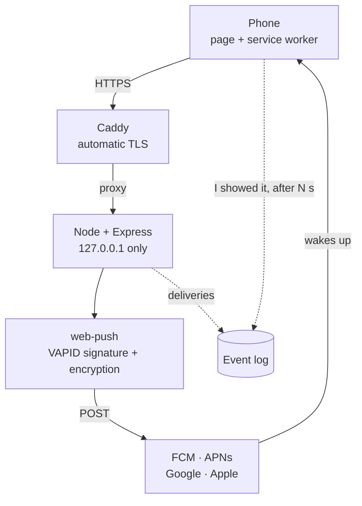
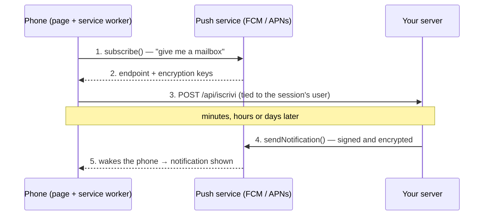
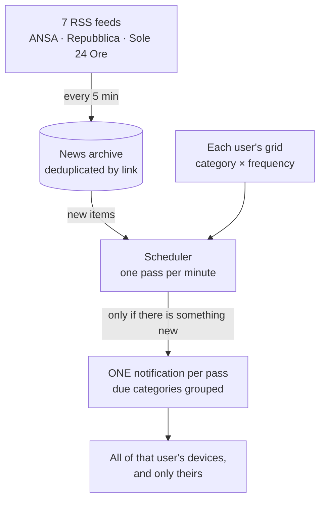
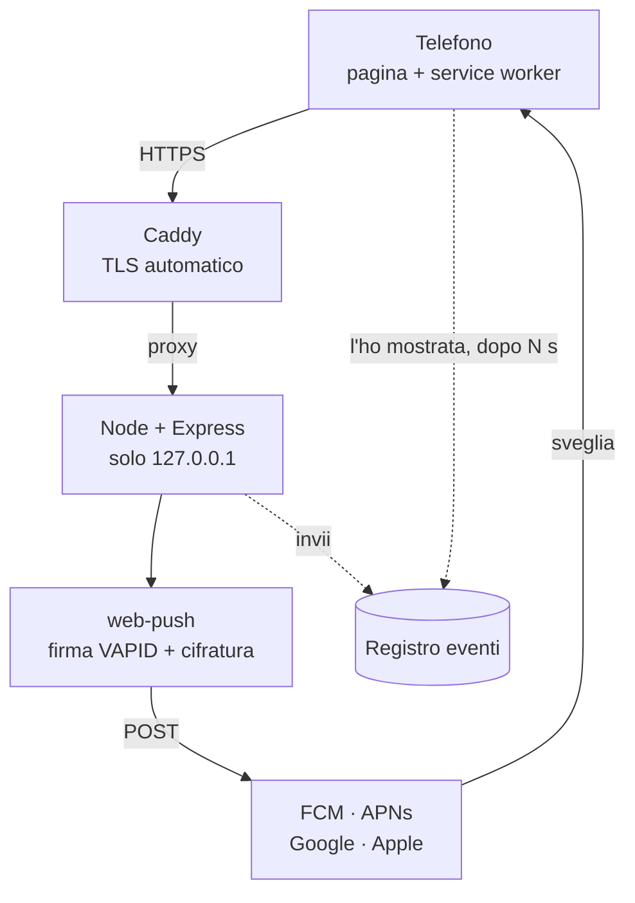
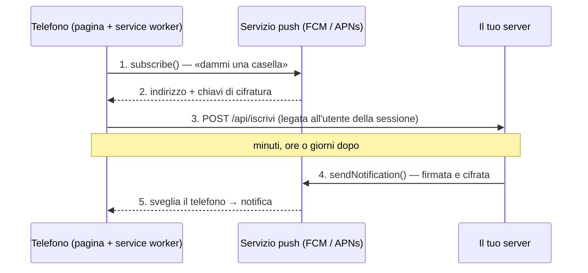
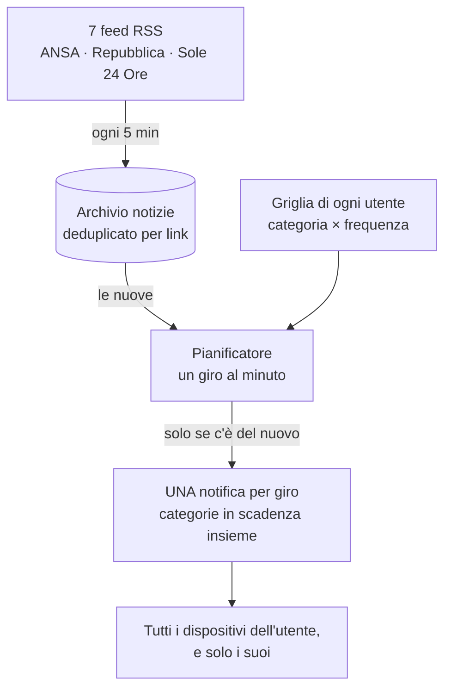

# pwa-push-lab

**Web Push notifications for installable PWAs on iPhone and Android — no Firebase, no SDK, no third parties.**
A working lab, a reusable install-prompt component, and a multi-user news demo built on top of them.

[English](#english) · [Italiano](#italiano)

Once deployed, the site also serves two long-form guides (in Italian):

| Page on your deployment | Source | Content |
|---|---|---|
| `/architettura` | [`public/architettura.html`](public/architettura.html) | architecture, diagrams, measured results, pitfalls |
| `/comunicazione` | [`public/comunicazione.htm`](public/comunicazione.htm) | the minimal app ↔ server push system, step by step |

---

<a id="english"></a>

## English

### What this is

Three things in one repository:

1. **A test bench** whose only goal was to make a push notification appear on a real
   iPhone and a real Android phone, and to write down what it actually took. The
   live site and the in-app texts are in Italian; the documentation is bilingual.
2. **[`<pwa-invito>`](componente/README.md)**, a dependency-free web component that
   guides users through installing the PWA and granting notification permission,
   with the right instructions for each platform and browser.
3. **A multi-user news site** that sends each user personalised push digests from
   real RSS feeds: politics, financial markets, sport, wars and macroeconomics, at a
   frequency each user chooses per category.

### What it proved — measured, not assumed

| Date | Device | System | Notification with the app closed | Measured delay |
|---|---|---|---|---|
| 2026-08-29 | iPhone | iOS 18.7, Safari 26.6 | ✅ **5 out of 5** | ~1 s from server to screen |

The device itself reports when a notification is displayed (`notifica-mostrata`):
the server only knows it *delivered* to Apple or Google, which is not the same thing.
Every result, including the defects found along the way, is in the *Esiti*
section of `/architettura` ([source](public/architettura.html)).

### The constraint that decides everything

On iOS, Web Push works **only inside a web app added to the Home Screen** (iOS 16.4+),
never in a browser tab. Since iOS 16.4 Safari, Chrome, Edge, Firefox and DuckDuckGo
can all add to the Home Screen; in-app browsers (Instagram, WhatsApp, Facebook) cannot.

| Platform | In the browser | Installed |
|---|---|---|
| Android — Chrome, Edge, Samsung Internet | yes | yes |
| iOS/iPadOS 16.4+ — Safari | **no** | yes |
| iOS 16.4+ — Chrome, Edge, Firefox, DuckDuckGo | no | **yes**, from the Share menu |
| iOS — in-app browsers | no | no |
| Desktop — Chrome, Edge, Firefox | yes | yes |

Things that **cannot** be done on iOS, and that this project does not pretend to do:
install the app from code (`navigator.install()` is Chromium-only), detect from Safari
whether the app is installed, or open a link inside the installed app.

### Architecture



Three runtime dependencies: `express`, `web-push`, `fast-xml-parser`. Storage is plain
JSON files with atomic writes — this is a lab, not a product, and a database would add
a service to keep alive without solving any problem we have.

### How one notification travels



Steps 1–3 happen once. Steps 4–5 happen every time. The server never talks to the
phone directly.

### The news site



Each user picks, **per category**, one of: off, every 5 minutes, hourly, daily, weekly.
The frequency is a *maximum*: no news, no notification.

### Quick start

```bash
git clone https://github.com/JoeBosi/pwa-push-lab.git
cd pwa-push-lab
npm install
VAPID_SUBJECT=mailto:you@example.com npm run chiavi   # VAPID keys + session secret → .env
npm run icone                                        # generates the PNG icons
npm test                                             # 118 tests, no network needed
npm start                                            # http://127.0.0.1:3020
node strumenti/utenti.js crea alice                  # prints a one-time initial password
node strumenti/utenti.js ruolo alice admin           # optional: make her admin
```

`localhost` counts as a secure context, so the service worker and the permission
prompt work locally. **A real phone needs a real domain with a valid certificate**:
see [`deploy/README.md`](deploy/README.md).

### Using it

The complete guide — for end users, for the admin, and for developers who want to
reuse the pieces — is in **[`docs/USAGE.md`](docs/USAGE.md)**. In short:

- **Users** log in with the password the admin gave them, are forced to choose their
  own, install the app, enable notifications and fill in their grid.
- **The admin** creates users and resets passwords at `/admin`. The admin role itself
  can only be granted from the server terminal.
- **Developers** can copy [`componente/pwa-invito.js`](componente/README.md) into any
  PWA, and follow the app ↔ server guide (`/comunicazione`,
  [source](public/comunicazione.htm)) for the minimal push backend.

### Security

Every defence has its own test in [`test/notizie.test.js`](test/notizie.test.js):

- passwords hashed with scrypt, compared in constant time; same error for unknown user
  and wrong password; lockout after 5 failures;
- the initial password only allows changing it; changing it **revokes sessions open
  elsewhere** (the signed cookie carries a version number);
- session cookie signed with HMAC, `HttpOnly; Secure; SameSite=Lax`;
- CSRF defence on origin and content type for every state-changing route;
- a device belongs to the user **of the session**, never to one declared by the page;
- logout removes **all** of the user's devices, so the next person holding the phone
  does not receive their notifications;
- `/api/invia` (broadcast) and the event log require a token, and stay **closed** if
  the token is not configured;
- feed titles enter the page only as text; links only if `http`/`https`;
- personal pages are never cached by the service worker.

No secret has ever been committed: `.env` and `data/` are git-ignored and generated on
the server.

### Tests

```bash
npm test
```

118 tests, no framework, no network. Among them: the service worker is **executed** in a
sandbox against five payload shapes (including an empty push) to prove that every push
event ends in a visible notification — a silent push makes Safari revoke the
subscription. What the tests do **not** prove: that a phone rings. That is checked on
real devices only, and logged.

### Project structure

```
componente/          the reusable install prompt — copy it into any PWA
server.js            Express: pages, API, auth, scheduler bootstrap
sw.js                service worker (at the root on purpose: scope)
lib/                 users · sessions · subscriptions · news · scheduler · event log
public/              pages, styles, client scripts
strumenti/           CLI: VAPID keys, icons, users, test bench
deploy/              systemd unit, Caddy vhost, idempotent deploy script
docs/                usage guide, UI audit, research notes with sources
test/                118 tests
.claude/ .agents/    portable agent environment (skills, sub-agents, commands)
```

### Documentation

| Document | Language | For |
|---|---|---|
| [`docs/USAGE.md`](docs/USAGE.md) | EN · IT | anyone using or reusing the project |
| [`componente/README.md`](componente/README.md) | EN · IT | developers reusing the install prompt |
| [`deploy/README.md`](deploy/README.md) | EN · IT | putting it online |
| [`docs/audit-interfaccia-2026-10-01.md`](docs/audit-interfaccia-2026-10-01.md) | IT | accessibility and readability audit |
| [`docs/research/`](docs/research/) | IT | primary sources, dated, with pitfalls |
| [`CLAUDE.md`](CLAUDE.md) | IT | rules for the AI agents working on this repo |

### License

[MIT](LICENSE).

---

<a id="italiano"></a>

## Italiano

### Che cos'è

Tre cose in un solo repository:

1. **Un banco di prova** nato per un solo scopo: far comparire una notifica push su un
   iPhone e su un Android veri, e scrivere che cosa è servito davvero. Il sito e i
   testi dell'app sono in italiano; la documentazione è in due lingue.
2. **[`<pwa-invito>`](componente/README.md)**, un componente web senza dipendenze che
   accompagna l'utente nell'installazione della PWA e nel permesso alle notifiche,
   con le istruzioni giuste per ogni sistema e browser.
3. **Un sito notizie multiutente** che manda a ciascun utente riepiloghi push
   personalizzati da feed RSS veri: politica, mercati finanziari, sport, guerre e
   macroeconomia, con la frequenza che ognuno sceglie per ogni categoria.

### Che cosa ha dimostrato — misurato, non supposto

| Data | Dispositivo | Sistema | Notifica ad app chiusa | Ritardo misurato |
|---|---|---|---|---|
| 29/08/2026 | iPhone | iOS 18.7, Safari 26.6 | ✅ **5 su 5** | ~1 s dal server allo schermo |

È il dispositivo stesso a riferire quando una notifica compare (`notifica-mostrata`):
il server sa soltanto di averla *consegnata* ad Apple o a Google, che è un'altra cosa.
Tutti gli esiti, compresi i difetti trovati per strada, sono nella sezione
*Esiti* di `/architettura` ([sorgente](public/architettura.html)).

### Il vincolo che decide tutto

Su iOS il Web Push funziona **solo dentro una web app aggiunta alla schermata Home**
(iOS 16.4 in poi), mai in una scheda del browser. Da iOS 16.4 possono aggiungere alla
Home Safari, Chrome, Edge, Firefox e DuckDuckGo; i browser dentro le app (Instagram,
WhatsApp, Facebook) no.

| Piattaforma | Nel browser | Installata |
|---|---|---|
| Android — Chrome, Edge, Samsung Internet | sì | sì |
| iOS/iPadOS 16.4+ — Safari | **no** | sì |
| iOS 16.4+ — Chrome, Edge, Firefox, DuckDuckGo | no | **sì**, dal menu Condividi |
| iOS — browser dentro le app | no | no |
| Desktop — Chrome, Edge, Firefox | sì | sì |

Cose che su iOS **non si possono** fare, e che questo progetto non finge di fare:
installare l'app da codice (`navigator.install()` esiste solo su Chromium), sapere da
Safari se l'app è installata, aprire un link dentro l'app installata.

### Architettura



Tre dipendenze: `express`, `web-push`, `fast-xml-parser`. I dati sono file JSON con
scrittura atomica: è un laboratorio, non un prodotto, e un database aggiungerebbe un
servizio da tenere vivo senza risolvere nessun problema reale.

### Il viaggio di una notifica



I passi 1–3 avvengono una volta, i passi 4–5 ogni volta. Il server non parla mai
direttamente col telefono.

### Il sito notizie



Ogni utente sceglie, **per ogni categoria**: no, ogni 5 minuti, ogni ora, ogni giorno,
ogni settimana. La frequenza è un *massimo*: senza notizie nuove, niente notifica.

### Avvio rapido

```bash
git clone https://github.com/JoeBosi/pwa-push-lab.git
cd pwa-push-lab
npm install
VAPID_SUBJECT=mailto:tu@esempio.it npm run chiavi    # chiavi VAPID + segreto di sessione → .env
npm run icone                                        # genera le icone PNG
npm test                                             # 118 test, senza rete
npm start                                            # http://127.0.0.1:3020
node strumenti/utenti.js crea alice                  # stampa una password iniziale da usare una volta
node strumenti/utenti.js ruolo alice admin           # facoltativo: la rende amministratrice
```

`localhost` è un contesto sicuro: in locale service worker e richiesta del permesso
funzionano. **Su un telefono vero servono un dominio vero e un certificato valido**:
vedi [`deploy/README.md`](deploy/README.md).

### Come si usa

La guida completa — per chi usa il sito, per l'amministratore e per chi vuole
riusarne i pezzi — è in **[`docs/USAGE.md`](docs/USAGE.md)**. In breve:

- **Gli utenti** entrano con la password ricevuta dall'amministratore, sono obbligati a
  sceglierne una loro, installano l'app, attivano le notifiche e compilano la griglia.
- **L'amministratore** crea utenti e reimposta password su `/admin`. Il ruolo di
  amministratore si assegna solo dal terminale del server.
- **Chi sviluppa** può copiare [`componente/pwa-invito.js`](componente/README.md) in
  qualunque PWA e seguire la guida app ↔ server (`/comunicazione`,
  [sorgente](public/comunicazione.htm)) per il server push minimo.

### Sicurezza

Ogni difesa ha il suo test in [`test/notizie.test.js`](test/notizie.test.js):

- password con scrypt, confronto a tempo costante; stesso messaggio per utente
  inesistente e password sbagliata; blocco dopo 5 tentativi;
- con la password iniziale si può solo cambiarla; cambiarla **chiude le sessioni
  aperte altrove** (il cookie firmato porta un numero di versione);
- cookie di sessione firmato HMAC, `HttpOnly; Secure; SameSite=Lax`;
- difesa CSRF su origine e tipo di contenuto per ogni rotta che modifica qualcosa;
- un dispositivo appartiene all'utente **della sessione**, mai a quello dichiarato
  dalla pagina;
- l'uscita toglie **tutti** i dispositivi dell'utente: chi ha il telefono dopo di lui
  non riceve le sue notifiche;
- `/api/invia` (invio a tutti) e il registro richiedono un token, e restano **chiusi**
  se il token non è configurato;
- i titoli dei feed entrano nella pagina solo come testo; i link solo se `http`/`https`;
- le pagine personali non finiscono mai nella cache del service worker.

Nessun segreto è mai stato committato: `.env` e `data/` sono esclusi da git e generati
sul server.

### Test

```bash
npm test
```

118 test, senza framework e senza rete. Fra questi: il service worker viene
**eseguito** in un ambiente isolato con cinque forme di payload (compreso il push
vuoto) per dimostrare che ogni evento push finisce in una notifica visibile — un push
muto fa revocare l'iscrizione da Safari. Che cosa i test **non** dimostrano: che un
telefono squilli. Quello si verifica solo sui dispositivi veri, e si annota.

### Struttura

```
componente/          l'invito all'installazione riusabile — si copia in qualunque PWA
server.js            Express: pagine, API, accesso, avvio del pianificatore
sw.js                service worker (nella radice apposta: scope)
lib/                 utenti · sessioni · iscrizioni · notizie · pianificatore · registro
public/              pagine, stili, script della pagina
strumenti/           da terminale: chiavi VAPID, icone, utenti, banco di prova
deploy/              unità systemd, vhost Caddy, script di deploy idempotente
docs/                guida d'uso, audit d'interfaccia, note di ricerca con fonti
test/                118 test
.claude/ .agents/    ambiente agentico portabile (skill, subagent, comandi)
```

### Documentazione

| Documento | Lingua | Per chi |
|---|---|---|
| [`docs/USAGE.md`](docs/USAGE.md) | EN · IT | chi usa o riusa il progetto |
| [`componente/README.md`](componente/README.md) | EN · IT | chi riusa l'invito all'installazione |
| [`deploy/README.md`](deploy/README.md) | EN · IT | la messa in linea |
| [`docs/audit-interfaccia-2026-10-01.md`](docs/audit-interfaccia-2026-10-01.md) | IT | audit di accessibilità e leggibilità |
| [`docs/research/`](docs/research/) | IT | fonti primarie, datate, con le trappole |
| [`CLAUDE.md`](CLAUDE.md) | IT | regole per gli agenti AI che lavorano qui |

### Licenza

[MIT](LICENSE).
